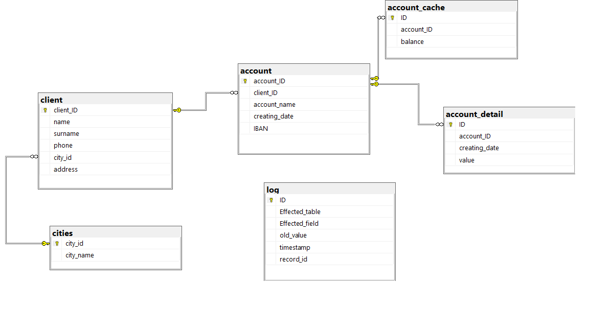

# Bank Information System (SQL Server)

A relational database management project built in **Microsoft SQL Server (T-SQL)** designed to handle core banking operations—including customer onboarding, automated Lithuanian IBAN generation (MOD-97 checksum), fund transfers, cached balance tracking, and audit logging.

---

## 📊 Entity-Relationship Diagram (ERD)



---

## 📁 Repository Structure

```text
Bank-Information-System/
├── README.md
├── database_files/
│   ├── Bank_Information_System.mdf
│   └── Bank_Information_System_log.ldf
├── scripts/
│   ├── 01_tables.sql
│   ├── 02_views.sql
│   └── 03_programmability.sql
└── images/
    └── erd_diagram.png
```

---

## 🗂️ Database Architecture

### 1. Tables (`scripts/01_tables.sql`)
* **`cities`** — Lookup table storing city names and IDs.
* **`client`** — Customer profile records (name, surname, phone, address, and city reference).
* **`account`** — Bank accounts linked to clients, storing account names, creation dates, and unique IBANs.
* **`account_cache`** — Real-time cached account balances for fast lookups.
* **`account_detail`** — Transaction ledger recording individual credit (`+`) and debit (`-`) entries.
* **`log`** — Automated audit trail capturing `INSERT` and `UPDATE` history across core tables.

### 2. Views (`scripts/02_views.sql`)
* **`Client_accounts`** — Joins `client`, `account`, and `account_cache` to display customer names alongside their IBANs and current balances.
* **`Customer_data`** — Joins `client` and `cities` to provide a unified customer directory.

### 3. Programmability (`scripts/03_programmability.sql`)
* **Scalar Function:**
  * `To_Generate_IBAN(@AccountID)` — Generates valid 20-character Lithuanian IBANs (`LT` + 2-digit MOD-97 checksum + branch code `70440` + 11-digit zero-padded account ID).
* **Table-Valued Function:**
  * `Customer_by_City(@CityID)` — Returns customers in a given city along with their aggregated EUR total balance across all accounts.
* **Stored Procedures:**
  * `Customer_Update` — Onboards a new customer (or reuses an existing one), opens a new account, generates an IBAN, and initializes cache/detail records.
  * `Amount_Transaction` — Executes atomic IBAN-to-IBAN transfers inside a transaction block with balance validation (`THROW 51000` on insufficient funds).
  * `Ins_Update` — Inserts and updates transaction records in `account_detail`.
* **DML Triggers:**
  * `Trigger_Account_Cache` — Automatically recalculates `account_cache.balance` whenever `account_detail` is modified.
  * `Trigger_LOG_Client`, `Trigger_LOG_Cities`, `Trigger_LOG_AccountCache`, `Trigger_LOG_AccountDetail` — Automatically record data modifications into the `log` table.

---

## 🚀 How to Run Locally

### Option A: Build From SQL Scripts (Recommended)
1. Open **SQL Server Management Studio (SSMS)** and connect to your SQL Server instance.
2. Open and execute the files in the `scripts/` folder in numerical order:
   1. `scripts/01_tables.sql` (creates the database and tables)
   2. `scripts/02_views.sql` (creates the views)
   3. `scripts/03_programmability.sql` (creates functions, stored procedures, and triggers)

### Option B: Attach Database Files Directly
1. Download `Bank_Information_System.mdf` and `Bank_Information_System_log.ldf` from `database_files/`.
2. Move both files into your SQL Server `DATA` directory (e.g., `C:\Program Files\Microsoft SQL Server\MSSQL16.SQLEXPRESS\MSSQL\DATA\`).
3. In SSMS, right-click **Databases** > **Attach...** > **Add...**, select `Bank_Information_System.mdf`, and click **OK**.

---

## 💡 Example Usage

```sql
-- 1. Create a new customer and open an account with an auto-generated IBAN
EXEC dbo.Customer_Update 
    @name = 'Jonas', 
    @surname = 'Kazlauskas', 
    @phone = '+37060000000', 
    @address = 'Gedimino pr. 1', 
    @city_name = 'Vilnius', 
    @account_name = 'Main Savings';

-- 2. Transfer funds between two IBANs
EXEC dbo.Amount_Transaction 
    @Credited_Acc_IBAN = 'LT127044000000000002', 
    @Debited_Acc_IBAN = 'LT347044000000000001', 
    @Value = 150.00;

-- 3. View all client accounts and balances
SELECT * FROM dbo.Client_accounts;

-- 4. Check total customer balances by city ID
SELECT * FROM dbo.Customer_by_City(1);
```

---

## 🛠️ Technologies Used
* **Database Engine:** Microsoft SQL Server
* **Language:** T-SQL
* **Tools:** SQL Server Management Studio (SSMS)
